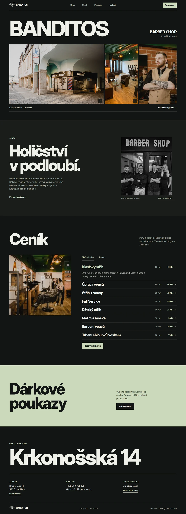
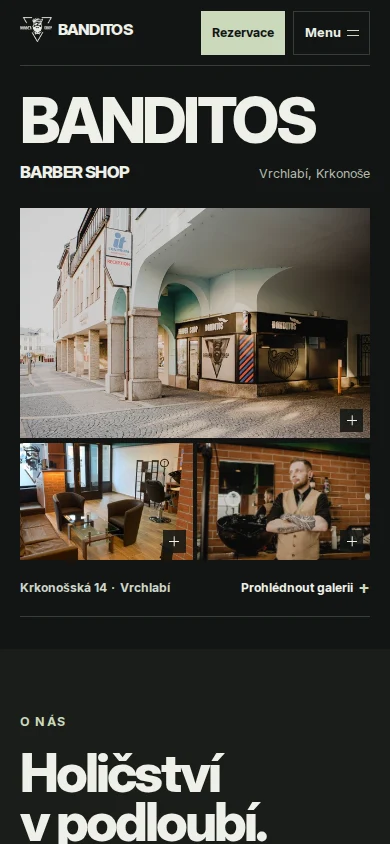
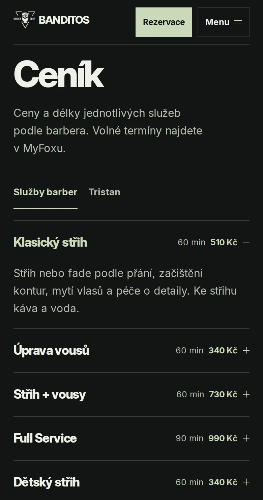
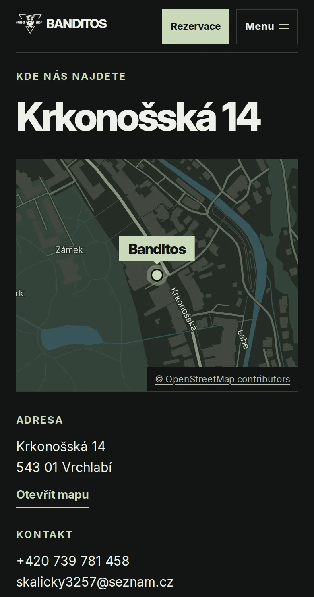

<h1 align="center">Banditos Barber Shop</h1>

<p align="center">A Czech-language portfolio redesign for the barbershop under the arcades of Vrchlabí.</p>

<p align="center"><b>Next.js</b> &nbsp;·&nbsp; React &nbsp;·&nbsp; TypeScript &nbsp;·&nbsp; Tailwind CSS &nbsp;·&nbsp; GSAP</p>

[](docs/screenshots/desktop-full.webp)

The first thing you see is the entrance on Krkonošská. Beside it are the chair and the barber, three photographs that take you from the street into the shop. The green ceiling inside inspired the sage accents used for booking, prices and the pin on the map. [View the full desktop page](docs/screenshots/desktop-full.webp)

## In your hand

<p>
  <a href="docs/screenshots/mobile.webp"></a>
  <a href="docs/screenshots/mobile-services.webp"></a>
  <a href="docs/screenshots/mobile-map.webp"></a>
</p>

On a phone, the storefront spans the screen and the interior and barber portrait sit below it. Visitors can browse seven shop photographs, compare prices by barber, open a service to see what it includes, or tap the map for directions. Booking and vouchers connect to the shop’s existing services.

## Motion and performance

The masthead and photos arrive in a short GSAP sequence. ScrollTrigger adds a slight shift to the desktop gallery as it leaves the viewport. Native scrolling and keyboard navigation work throughout, and the site respects reduced-motion preferences. The photographs, fonts and illustrated street map are served locally as part of the static export.

## Run locally

Use Node.js 20.9 or later.

```sh
git clone https://github.com/HMan4256/banditos-barber-shop.git
cd banditos-barber-shop
npm ci
npm run dev
```

Open [localhost:3000](http://localhost:3000). Run `npm run typecheck` to check TypeScript or `npm run build` to generate the static site in `out/`.

## Credits

This independent portfolio project features Banditos Barber Shop at Krkonošská 14, Vrchlabí.

- Storefront, barber portraits, logo and service information come from the [shop’s official website](https://banditos-barber-shop.myfox.cz/).
- The green-ceiling interior photograph comes from the [Vrchlabí business directory](https://www.vrchlabi.org/banditos-barber-shop/).
- The team portrait outside the shop appeared in [PULS, August 2025, page 24](https://www.muvrchlabi.cz/modules/file_storage/download.php?file=294b4fd9%7C2680&inline=1).
- Street geometry and landmarks are based on data from [© OpenStreetMap contributors](https://www.openstreetmap.org/copyright).
